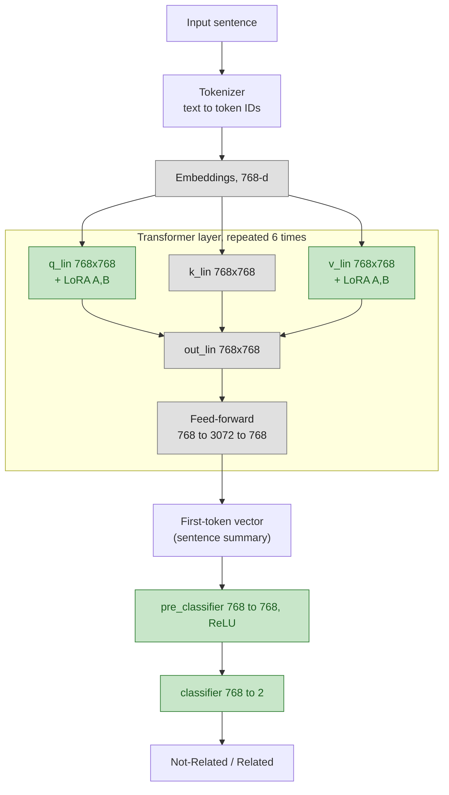
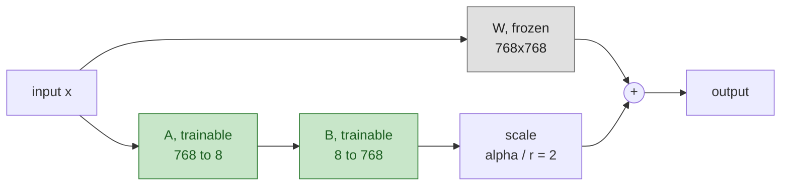
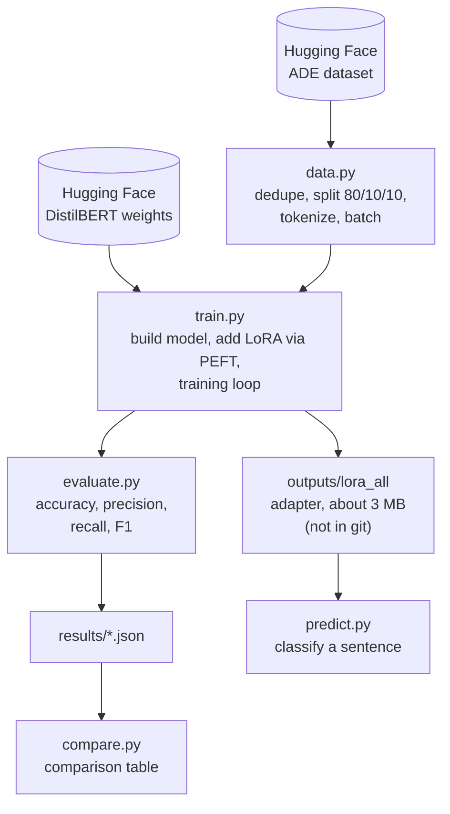

# Architecture

Adverse drug event (ADE) detection with DistilBERT and LoRA.
Green nodes are trained; grey nodes are frozen.

## 1. Model

Trainable weights: 739,586 of 67,694,596 (1.09%).
LoRA adapters on q and v: 147,456. Classifier head: 592,130.

## 2. LoRA inside one attention matrix

B starts at zero, so training begins from the original model's behaviour.

## 3. Code flow

`lora_layer.py` is a hand-written teaching version of LoRA and is not used by `train.py`.
